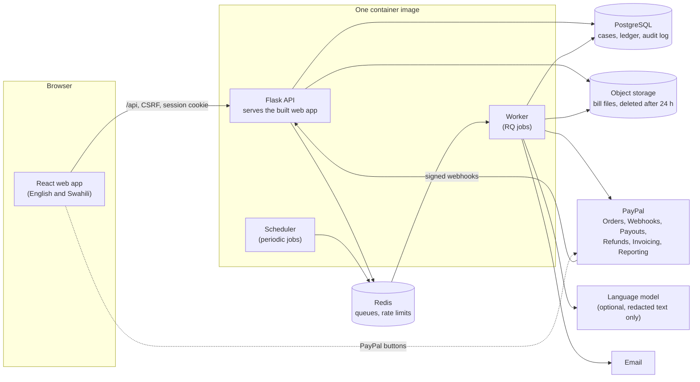

# TibaDirect

Verified medical fundraising that pays the hospital, not a stranger's phone number.

> **Hackathon prototype.** All people, hospitals and bills are made up and all money is PayPal
> sandbox money. Hosted demo: **<https://tibadirect.onrender.com>** (free plan: the first visit after a quiet spell takes about a minute to wake).  Demo video: _(video URL: add before submission)_.

## The problem

Kenyan families regularly ask relatives and friends abroad to help with a hospital bill. The appeal
travels as a WhatsApp message with a phone number to send money to. Donors cannot tell a real bill
from a fake one, scammers copy real stories, and a real family can wait weeks for money that never
reaches the hospital. Giving to a stranger's number is a leap of faith, so people give less, or not at all.

## What TibaDirect does

1. A family uploads the hospital bill and agrees, one use at a time, to what happens with it.
2. Software reads the bill, **removes names, numbers and medical terms**, and looks for signs it was
   altered or used before. It never rejects anyone: it flags, and a person decides.
3. The **hospital confirms the bill itself**, with a one-time code sent to the contact listed in the
   public facility register, not to the family. Big bills need a second person.
4. Donors, including people abroad, give through **PayPal**. They choose what happens to any money left over.
5. The hospital is **paid directly, in parts, as money arrives**. Every movement is written to a public,
   hash-chained ledger that anyone can verify in one click.
6. If the final bill is lower, or treatment ends early, leftover money is refunded, pooled or held as each donor chose.
   If a case looks fraudulent an administrator freezes it and every donor is refunded.

Donations never sit with the family or with TibaDirect. In production the PayPal collector account
belongs to an approved partner or a registered non-profit that PayPal has cleared to take donations
(PayPal requires this pre-approval), never to families.

## Run it in three commands

You need Docker with Compose.

```bash
cp .env.example .env
docker compose --profile app up -d --build
docker compose exec api flask seed
```

Open <http://localhost:5000>. Emailed sign-in codes appear in Mailpit at <http://localhost:8025>.
`/api/docs` is the interactive API documentation. Accounts and a click-by-click demo story are listed
under [Sandbox accounts](#sandbox-accounts).

Working on the code instead? `make up` starts only PostgreSQL, Redis, MinIO and Mailpit, then
`make migrate seed`, `make test`, `make web` (see the [Makefile](Makefile)).

## Architecture



- **Backend:** Python 3.12, Flask, SQLAlchemy, Alembic, PostgreSQL 16, Redis and RQ. Routes are thin;
  rules live in `backend/app/services`; money moves only through the ledger service, which appends
  hash-chained entries inside the same transaction as the change they record.
- **Frontend:** React, TypeScript, Vite, Tailwind, Radix, TanStack Query, AG Grid for the ledger, i18next.
- **Deployment:** one Docker image (web, worker, scheduler), `render.yaml` for Render, `docker-compose.yml` for local.

## What is real and what is simulated

| Part | Status |
|---|---|
| Web app, API, database, queues, ledger, audit log | **Real**: the same code runs locally and on Render |
| Bill reading (PDF text layer, Tesseract OCR), redaction, tamper and duplicate checks, risk score, appeal checker | **Real**: runs on our servers with no outside call |
| Language model for extraction, the appeal explanation and the treasurer agent | **Real but optional**: needs a key; without one the local reader and rules decide |
| PayPal | **Real sandbox code path** with keys set (`PAYPAL_MODE=sandbox`); without keys a built-in simulation answers the same calls, so every flow runs offline (the button then says "simulated") |
| Hospitals, patients, bills, donors, the facility register, WhatsApp appeals | **Simulated**: fictional, with reserved `.test` email addresses; no real facility is named |
| Hospital payouts | **Simulated by design**: the hospital's PayPal address is a sandbox account. A real service would pay a hospital's bank or paybill through a licensed partner (adapters are in place) |
| Sign-in codes | Emailed for real; locally they land in Mailpit. On the hosted demo they **show on screen** (and the hospital's confirmation code too), because the demo accounts use made-up addresses and the free plan cannot send mail |
| Swahili text | Complete but **not yet reviewed by a native speaker** (`docs/i18n/swahili-review.csv` lists what to check first) |

## PayPal APIs used

| API | Used for |
|---|---|
| Orders v2 (`/v2/checkout/orders`, capture) and the JavaScript SDK buttons | The donor's payment, with idempotency keys and a second capture path from webhooks |
| Webhooks (`/v1/notifications/verify-webhook-signature`) | Every event is verified through PayPal, stored once by event id, then processed; forged and replayed events change nothing |
| Payouts (`/v1/payments/payouts`) | Paying the hospital in tranches (the sandbox account stands in for the hospital); followed until PayPal says it is paid or failed |
| Payments refunds (`/v2/payments/captures/{id}/refund`) | Excess-money policy, case cancellation and the fraud freeze |
| Invoicing v2 (`/v2/invoicing`) | A PayPal invoice for the hospital's confirmed bill, with each tranche recorded as a payment on it |
| Transaction search (`/v1/reporting/transactions`) | The treasurer agent's read tool for checking the books against PayPal |

## AI tools used and how

| Where | Tool | What it does | Notes |
|---|---|---|---|
| Reading bills | `pypdf` text layer, **Tesseract** OCR (photos and scans) | Gets text and amounts from an uploaded bill | Local, no outside call |
| Privacy | Rule-based redaction with medical and name lexicons | Removes names, phones, ID numbers, the patient number and medical terms **before** anything is stored or sent anywhere | Tested on every synthetic bill and across the whole database |
| Extraction | **Google Gemini** (`gemini-flash-lite-latest`, free tier) on the hosted demo, with a tool schema; Claude is also supported (`LLM_PROVIDER`, `LLM_MODEL`) | Fills in fields the local reader missed, only with the family's consent and only from redacted text | Output is schema-checked and cross-checked against the local reading; the local amount always wins |
| Tamper and duplicate checks | PDF structure, fonts, metadata, error-level analysis, perceptual hash, text fingerprint | Raise signals with fixed weights | Explainable: every flag has a reason in plain words |
| Risk score and routing | Fixed weights, three bands | Sends a bill to the hospital or to a person | Never approves or rejects anyone |
| Appeal checker | scikit-learn TF-IDF + logistic regression with rule features | Scores a forwarded WhatsApp appeal | Trained on 100 synthetic appeals; input is hashed and not stored |
| Treasurer agent (admin only) | Gemini (or Claude) with read tools | Answers questions about the money and **proposes** actions | A person approves every action; nothing moves on its own |
| Building the project | **Claude Code** (Anthropic) as a pair-programming tool | Wrote and refactored code and tests under the team's specification and review | Every change is a small commit with its own tests |

Bills that contain instructions aimed at software ("ignore previous instructions...") are held for a person, and
tests prove the figures cannot change.

## Evaluation

`flask ai evaluate` scores the 92 synthetic bills (36 genuine, 32 tampered, 24 duplicates) and writes a report.
Honest summary of the first run, using the local reader and rules only (no language model key was set):

- Tampered bills with at least one signal raised: **88%** (target 70%). Lifted to medium or high or sent to review: **44%** (target 70%, not met).
- Reused invoices sent to review: **83%** (target 100%, not met).
- Field accuracy on genuine bills: **100%** on digital PDFs, **72%** on photographs and scans (target 85%, not met).
- Appeal checker precision on the held-out messages: **100%**.
- Genuine bills with no false alarm: **100%**.

The gaps are listed in the report with the bills that caused them. Run it yourself with `make eval`.

## Security and privacy

- **Hospital confirmation is the gate.** Software only flags. Money cannot move to a hospital without a confirmed bill, a code sent to the register contact, and (for large bills) a second person.
- **Privacy by reduction.** Names, phones, ID numbers, the patient number and medical terms are removed from bill text before storage; the patient number is encrypted; the bill file is deleted 24 hours after the hospital decides; logs carry no personal data; consents are separate, versioned and withdrawable.
- **Tested boundaries.** Every one of the 60 API routes has a declared gate (public, signed in, family, hospital, administrator, webhook) and a test for wrong roles, missing CSRF tokens, and another account's ids. Rate limits, security headers, no-store caching, upload abuse, forged and replayed webhooks, double capture and prompt injection all have regression tests. `pip-audit` and `npm audit` run in CI.
- **Verifiable money.** The public ledger is a hash chain; **Verify ledger** on any case page recomputes every fingerprint on the server and says whether the chain is intact.
- **Notices.** The privacy notice and terms are in the app (footer) in English and Swahili. They are drafts that no lawyer has reviewed.

## Tests

- Backend: **3,061** tests (`make test`, parallel, about 6 minutes on a laptop), coverage **97.6%**.
- Frontend: **297** unit tests including axe accessibility checks (`make web-check`).
- Browser: six end-to-end flows on the simulated PayPal (happy path, altered bill to manual review, duplicate bill, hospital query, freeze with refunds, excess money), accessibility and phone-size checks, run in CI (`make e2e`).
- Timing: ten bills sent at once are all checked in about 2 seconds on one worker.

## Repository layout

```text
.
├── backend/                 Flask API and background jobs
│   ├── app/api/             HTTP routes (thin: validate, call a service, serialise)
│   ├── app/services/        business rules: ledger, settlement, refunds, excess policy, ...
│   ├── app/ai/              reading, redaction, tamper and duplicate checks, risk, appeal checker
│   ├── app/payments/        PayPal client, the offline simulation, webhook handling, payout adapters
│   ├── migrations/          Alembic migrations
│   └── tests/               pytest suite (api, services, ai, security, privacy, resilience, performance)
├── frontend/                React web app and its Playwright browser tests (e2e/)
├── data/                    synthetic bills, appeals, facility register, lexicons
├── docs/api/openapi.json    the API document the web app's types are generated from
├── docker-compose.yml       local PostgreSQL, Redis, MinIO, Mailpit (+ app services)
├── Dockerfile               one image for the web service, worker and scheduler
└── render.yaml              Render Blueprint
```

Working documents (design, decision log, test scripts, compliance drafts, phase reviews) are kept by the team and are not in this repository; the privacy notice and terms that people read are in `frontend/src/legal/`.

## Sandbox accounts

**On the hosted demo** (<https://tibadirect.onrender.com>): sign in with any address below; the code appears on screen and is
filled in for you. To donate, log in to PayPal's sandbox window with a **PayPal sandbox Personal account** (your own from
developer.paypal.com works). Sandbox buyers registered in some countries, Kenya included, get their payments held for review
by PayPal; a US sandbox buyer clears at once.

Locally, sign in with an emailed code (Mailpit locally): `admin@tibadirect.test`, `family1@example.test` to `family4@example.test`,
`clerk@kilele-hospital.test` and `supervisor@kilele-hospital.test` (also `mtomwema-` and `ziwabluu-` hospitals). The hospital's
one-time code goes to its register address, `billing@kilele-hospital.test`. Any other address becomes a family account.
`make reset-demo` wipes the demo database and loads the seed again; it only runs where `DEMO_BANNER` is on.

A demo story to follow: check a scam appeal at `/check`; as a family, start a page for Kilele and upload
`data/synthetic/invoices/INV-049.pdf`; as the Kilele clerk, confirm it (type 66700 and the invoice number from the bill, then the code from
`billing@kilele-hospital.test`); as a donor, give $50; watch the first payment and **Verify ledger**; upload the final bill and watch
the case close and the leftover go back. The seeded case **Baraka** is already live with donations and a payment.

## Documentation

| Where | What |
|---|---|
| `/api/docs` (running app), `docs/api/openapi.json` | The full API contract; the web app's types are generated from it and CI checks they match |
| `frontend/src/legal/` | The privacy notice and terms of use, in English and Swahili |
| `backend/app/consent_texts/` | The wording of each consent, versioned, in English and Swahili |
| `docs/i18n/swahili-review.csv` | Every Swahili string, with the ones to check first |
| `docs/phase-reviews/phase4/` | Screenshots of the whole flow, from the family's bill to the refund |
| `frontend/e2e/` | The browser tests, which double as a walkthrough of each flow |
| `.github/workflows/ci.yml` | What CI runs: lint, migrations up and down, evaluation, tests, browser flows, dependency audit, secret scan |

## Roadmap

- **A licensed partner or registered non-profit** as the PayPal collector, and bank or paybill payouts to hospitals through a licensed payment partner (the adapters exist; the sandbox account stands in).
- **M-Pesa** for donors and families in Kenya, alongside PayPal.
- **KYC** for the collector and for hospital onboarding, with the real **Kenya Master Health Facility Registry** instead of the fictional register.
- Native review of the Swahili, a lawyer's review of the notices, ODPC registration, data processing agreements with hospitals.
- Photos on case pages, donor updates, and a measured language-model run of the evaluation.

## Licence and team

[MIT](LICENSE). Built by the TibaDirect team during the hackathon: _(team names: add before submission)_.
