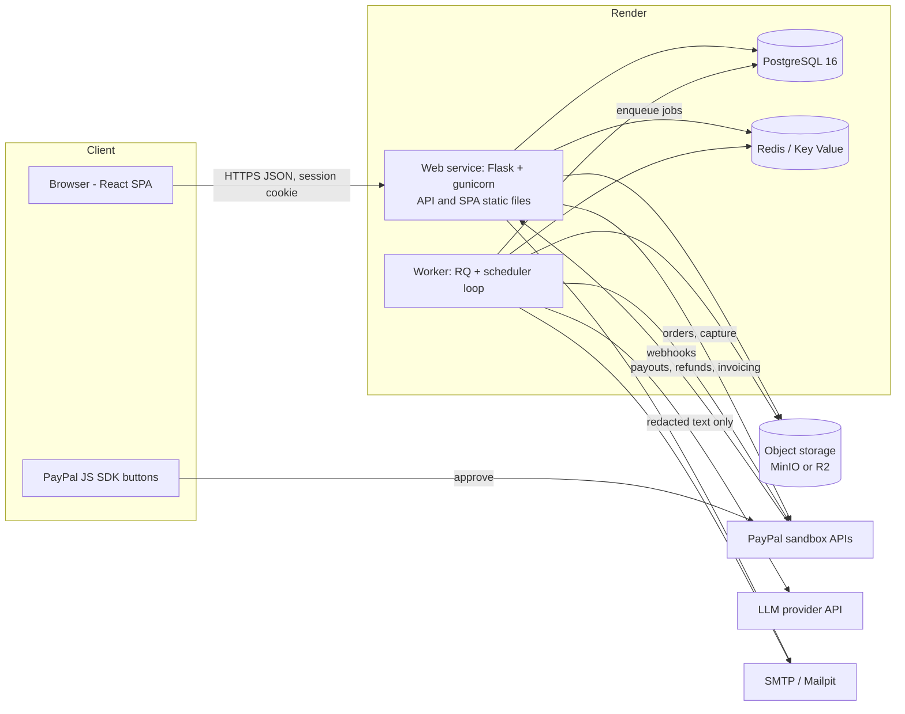
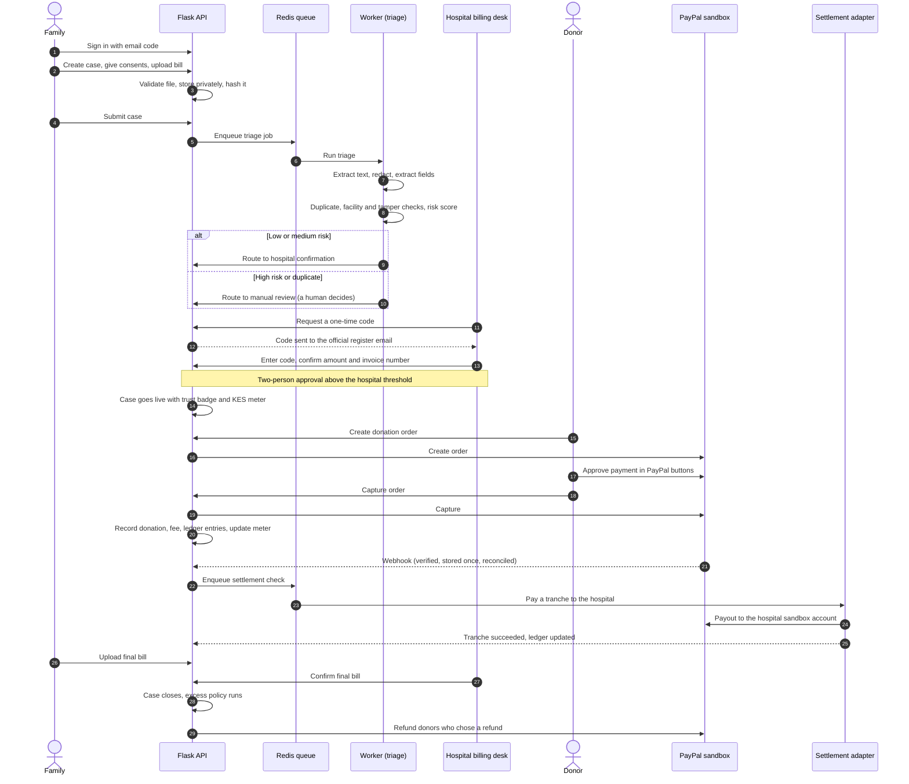

# TibaDirect system design

TibaDirect is verified medical fundraising that pays the hospital, not a stranger's phone number.
A family raises money for a hospital bill, the hospital confirms the bill through its official contact,
diaspora donors pay in USD through PayPal, and the money is settled to the hospital in tranches.

Two lines the design must always embody:

- **We verify the bill, not the illness.**
- **The donor's money touches the hospital, never a middleman.**

## 1. Context

| Actor | What they do |
|---|---|
| Family member | Signs in with an email code, picks the hospital, gives consent, uploads the bill, shares the case page |
| Hospital billing clerk and supervisor | Receive a one-time code at the hospital's official register email, confirm the amount and invoice number, approve large bills as a second person |
| Donor | Pays by PayPal in USD, chooses what happens to any excess, can verify the public ledger |
| Admin | Reviews flagged cases, freezes suspicious ones, monitors jobs and the ledger |
| PayPal (sandbox) | Collects donations, sends webhooks, pays settlement tranches, refunds donors |
| Language model provider | Optional. Receives redacted text only, with a separate consent |

## 2. Runtime topology



Flask serves the built React app in production, so there is one origin, first-party cookies, no CORS and a
single deployable. In development the Vite dev server proxies `/api` to Flask.

## 3. Code layering

```text
API routes  ->  services  ->  models
```

- **Routes** (`app/api`) validate input, call a service and serialise the result. No business logic.
- **Services** (`app/services`) hold the rules. They never import Flask request objects.
- **Models** (`app/models`) describe the schema and may only read their own state.
- State changes are audited through one audit service; money movements write ledger entries in the same
  database transaction.

## 4. The core flow



## 5. Trust leg and money leg

The product has two separate legs, and the second never starts before the first is complete.

**Trust leg: is this bill real?**

1. The family uploads the bill with layered consent.
2. The AI engine redacts medical details, reads the amount and facility, checks for tampering, duplicates and
   scam patterns, and produces a risk score with plain-language reasons. It triages and explains; it never
   approves or rejects.
3. High-risk and duplicate cases go to a human review queue. A human decides, with a mandatory note.
4. The hospital confirms the bill through the contact in the **facility register**, never a contact printed on the
   uploaded document. Above a threshold, a second staff member must approve.
5. Only then does the case page go live.

**Money leg: does the money reach the hospital?**

1. The donor pays in USD through PayPal Checkout. The capture is recorded immediately and webhooks reconcile.
2. The case target is in KES, with a buffer for FX and fees. The page shows pledged and settled separately.
3. The settlement engine pays the hospital in tranches. While the bill is only an estimate, no more than 80 percent
   of it settles before the final bill is confirmed.
4. Every movement of money is an entry in a public, hash-chained, append-only ledger that anyone can verify.
5. When the case closes, unused funds follow each donor's choice: refund, solidarity pool, or follow-up care for
   the same patient. A frozen case refunds everyone.

TibaDirect never holds funds. In the hackathon the collector account stands in for an approved partner or
registered non-profit; in production it would never belong to a family.

## 6. Real and simulated

| Area | In the hackathon build |
|---|---|
| Patients, hospitals, documents | Simulated. All data is synthetic and every hospital is fictional |
| Money | Simulated. PayPal sandbox only |
| PayPal Orders, capture, webhooks, refunds, payouts | Real PayPal sandbox APIs, with an in-process mock for tests and offline runs |
| Settlement to the hospital | Simulated. PayPal Payouts to the hospital's sandbox account stands in for a licensed Kenyan settlement partner. The adapter interface exists and the UI labels the step |
| Hospital register | A static, fictional extract |
| Hospital confirmation codes | Real flow, delivered by email (captured by Mailpit in development) |
| Redaction, duplicate, tamper and facility checks, risk score | Real, local |
| Structured extraction by a language model | Real when a key and the separate consent are present, otherwise a local fallback |
| Hosting | Render, with a docker-compose path for running locally |

## 7. Data protection design

- **Minimisation.** No column stores a diagnosis, procedure, test result or national ID. Uploaded text is stored
  only after redaction. Raw files are deleted after confirmation.
- **Encryption.** Patient reference, donor email and settlement account references are encrypted with AES-256-GCM
  and matched through HMAC lookup hashes.
- **Cross-border processing.** Only redacted text can reach the language model provider, and only with the separate
  `ai_processing_abroad` consent. Without it the local extractor runs.
- **Human decisions.** The AI never rejects a case. Flags go to a person who must write a reason.
- **Children.** A minor's case needs guardian consent and hides the photo by default.

## 8. Threat model (stub)

The full model is written in `docs/architecture/THREAT_MODEL.md` during the security phase. The threats it must
cover, each with a mitigation and a test reference:

fake invoice · reused invoice · same patient in two campaigns · insider confirmation · account takeover through
the email code · forged webhook · replayed webhook · double capture · access to another user's data (IDOR) ·
malicious PDF · prompt injection in a document · scraping of public pages · donor personal data leaking through
the ledger · secrets leaking into the repository.

## 9. Deployment

| Environment | Where | Data | PayPal |
|---|---|---|---|
| Local | docker-compose | Seed and synthetic | Sandbox or mock |
| Test | CI and pytest | Factories | Mock |
| Staging | Render, auto-deploy from `main` | Seed and synthetic | Sandbox |
| Demo | Render, frozen release | Resettable demo seed | Sandbox |

Render runs one Docker web service (API and built SPA), one worker with a scheduler loop, managed PostgreSQL and
Key Value (Redis). Object storage is external (Cloudflare R2 or S3) and MinIO locally.

See also: [database design](../database/DATABASE_DESIGN.md).
