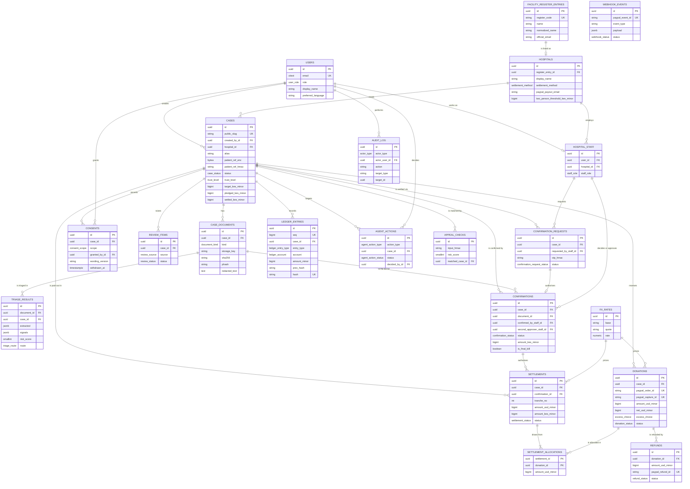
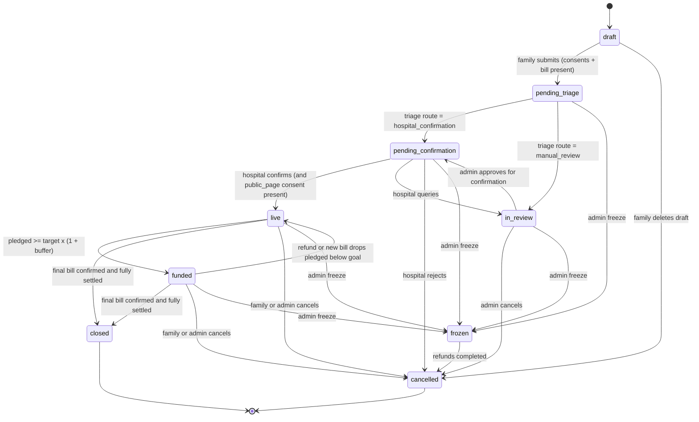

# TibaDirect database design

PostgreSQL 16 schema for TibaDirect. This document is the reference for the SQLAlchemy models and the
Alembic migrations; the code and this document must agree. Money, identifiers and the append-only
ledger are the parts of the design that matter most for trust, so they are described first.

The schema has **22 tables** across six groups:

- Identity: `users`, `login_codes`
- Hospitals: `facility_register_entries`, `hospitals`, `hospital_staff`
- Cases: `cases`, `case_documents`, `triage_results`, `consents`, `review_items`
- Verification: `confirmation_requests`, `confirmations`
- Money: `fx_rates`, `donations`, `settlements`, `settlement_allocations`, `refunds`, `ledger_entries`
- Integration: `webhook_events`
- Platform: `appeal_checks`, `audit_log`, `agent_actions`

## 1. Design principles

1. **UUID primary keys** (`uuid4`) on every table, so IDs in URLs cannot be guessed or enumerated. Public case URLs use a separate short random `public_slug`.
2. **Money is integer minor units.** `*_usd_minor` = US cents, `*_kes_minor` = KES cents (1 KES = 100). Never floats. FX rates are `NUMERIC(18,8)`. Conversions use `decimal.Decimal` with `ROUND_HALF_UP`.
3. **No medical facts are stored.** There is no column for diagnosis, procedure, drug, test result or national ID. Uploaded document text is stored **only after redaction**. Raw files are deleted after confirmation.
4. **Sensitive identifiers are encrypted and hashed.** Patient reference, donor email and hospital settlement account are stored encrypted (AES-256-GCM, `BYTEA`) plus an HMAC-SHA256 lookup hash for matching without decryption.
5. **Money history is append-only.** `ledger_entries` is hash-chained and protected by a database trigger that rejects `UPDATE` and `DELETE`.
6. **The database enforces invariants**: native Postgres enums, `CHECK` constraints for non-negative money and valid ranges, unique constraints for every external ID (PayPal order, capture, refund, event), partial unique indexes for "one active consent per scope".

All tables have `created_at TIMESTAMPTZ NOT NULL DEFAULT now()`; mutable tables also have `updated_at`. All timestamps are UTC; the UI displays EAT.

## 2. Entity-relationship diagram



**Table groups (21 tables):**
- Identity: `users`, `login_codes`
- Hospitals: `facility_register_entries`, `hospitals`, `hospital_staff`
- Cases: `cases`, `case_documents`, `triage_results`, `consents`, `review_items`
- Verification: `confirmation_requests`, `confirmations`
- Money: `fx_rates`, `donations`, `settlements`, `settlement_allocations`, `refunds`, `ledger_entries`
- Integration: `webhook_events`
- Platform: `appeal_checks`, `audit_log`, `agent_actions`

## 3. Enumerations (Postgres native enums)

| Enum | Values |
|---|---|
| `user_role` | `family`, `hospital_staff`, `admin` |
| `staff_role` | `billing_clerk`, `billing_supervisor` |
| `settlement_method` | `paypal_payouts`, `mock_partner`, `jenga` |
| `case_status` | `draft`, `pending_triage`, `in_review`, `pending_confirmation`, `live`, `funded`, `closed`, `cancelled`, `frozen` |
| `trust_level` | `unverified`, `pending_confirmation`, `hospital_confirmed` |
| `close_reason` | `fully_settled`, `final_bill_lower`, `treatment_cancelled`, `patient_deceased`, `admin_cancelled`, `fraud` |
| `document_kind` | `invoice`, `estimate`, `final_bill`, `photo` |
| `document_status` | `uploaded`, `processing`, `triaged`, `failed` |
| `risk_band` | `low`, `medium`, `high` |
| `triage_route` | `hospital_confirmation`, `manual_review` |
| `consent_scope` | `hospital_verification`, `public_page`, `ai_processing_abroad`, `receipt_sharing` |
| `consent_actor` | `self`, `guardian`, `administrator` |
| `otp_channel` | `email`, `sms` |
| `confirmation_request_status` | `sent`, `verified`, `expired`, `locked` |
| `confirmation_status` | `awaiting_second_approval`, `confirmed`, `queried`, `rejected` |
| `excess_choice` | `refund`, `solidarity_pool`, `follow_up_care` |
| `donation_status` | `created`, `captured`, `partially_refunded`, `refunded`, `reversed`, `denied`, `not_captured_case_closed` |
| `settlement_status` | `pending`, `processing`, `succeeded`, `failed` |
| `refund_reason` | `excess_policy`, `freeze`, `cancellation`, `admin` |
| `refund_status` | `pending`, `succeeded`, `failed` |
| `ledger_entry_type` | `donation_captured`, `paypal_fee`, `settlement_sent`, `refund_issued`, `pool_transfer`, `reversal`, `adjustment` |
| `ledger_account` | `case_funds`, `paypal_fees`, `hospital_settled`, `donor_refunds`, `solidarity_pool` |
| `webhook_status` | `received`, `processed`, `ignored`, `failed` |
| `review_source` | `ai_flag`, `family_request`, `insider_anomaly`, `admin` |
| `review_status` | `open`, `resolved` |
| `review_resolution` | `approved_for_confirmation`, `kept_unverified`, `case_cancelled`, `no_action` |
| `actor_type` | `user`, `system`, `agent`, `paypal` |
| `agent_action_type` | `refund`, `payout`, `freeze` |
| `agent_action_status` | `proposed`, `approved`, `rejected`, `executed`, `failed` |
| `appeal_input_kind` | `text`, `image` |

Implement them as Python `enum.StrEnum` classes in `app/models/enums.py`, mapped with `sqlalchemy.Enum(PyEnum, name="<enum_name>", values_callable=lambda e: [m.value for m in e])` so the database stores the lowercase values.

## 4. Data dictionary

Conventions in the tables below: `PK` primary key, `FK→t` foreign key to table `t`, `UQ` unique, `NN` not null, `IX` indexed. Every table also has `id UUID PK` and `created_at` (not repeated). `updated_at` is listed where the row is mutable.

### users
| Column | Type | Constraints | Notes |
|---|---|---|---|
| email | CITEXT | NN, UQ | Login identity |
| display_name | VARCHAR(80) | NN | Shown to staff only |
| phone | VARCHAR(20) | null | Optional, E.164; never logged |
| role | user_role | NN, IX | |
| preferred_language | VARCHAR(2) | NN, default `en` | `en` or `sw` |
| is_active | BOOLEAN | NN, default true | |
| last_login_at | TIMESTAMPTZ | null | |
| updated_at | TIMESTAMPTZ | NN | |

### login_codes
| Column | Type | Constraints | Notes |
|---|---|---|---|
| email | CITEXT | NN, IX | Code may be for a not-yet-created user |
| code_hmac | CHAR(64) | NN | HMAC of the 6-digit code; plain code never stored |
| expires_at | TIMESTAMPTZ | NN | now + 10 min |
| attempts | SMALLINT | NN, default 0, CHECK 0–10 | Locked after 5 |
| consumed_at | TIMESTAMPTZ | null | One-time use |
| ip_hmac | CHAR(64) | null | Rate-limit forensics without storing IP |

### facility_register_entries
Static extract of the public facility register (synthetic, fictional names for the hackathon).

| Column | Type | Constraints | Notes |
|---|---|---|---|
| register_code | VARCHAR(32) | NN, UQ | Register identifier |
| name | VARCHAR(160) | NN | |
| normalized_name | VARCHAR(160) | NN, IX | Lowercase, no punctuation, for fuzzy match |
| county | VARCHAR(40) | NN | |
| facility_level | VARCHAR(20) | null | e.g. Level 4 |
| ownership | VARCHAR(20) | null | private / faith-based / public |
| official_email | VARCHAR(160) | NN | **Only** channel for confirmation OTPs |
| official_phone | VARCHAR(20) | null | |
| source | VARCHAR(80) | NN | e.g. `synthetic-register-v1` |

### hospitals
| Column | Type | Constraints | Notes |
|---|---|---|---|
| register_entry_id | UUID | NN, UQ, FK→facility_register_entries | One hospital per register entry |
| display_name | VARCHAR(160) | NN | |
| county | VARCHAR(40) | NN | |
| is_active | BOOLEAN | NN, default true | Only active hospitals appear in the wizard |
| settlement_method | settlement_method | NN, default `paypal_payouts` | |
| paypal_payout_email | VARCHAR(160) | null | Hospital's sandbox business account |
| settlement_account_ref_enc | BYTEA | null | Encrypted paybill/bank ref (future partner) |
| two_person_threshold_kes_minor | BIGINT | NN, CHECK ≥ 0 | Default 200,000 KES × 100 |
| updated_at | TIMESTAMPTZ | NN | |

### hospital_staff
| Column | Type | Constraints | Notes |
|---|---|---|---|
| user_id | UUID | NN, UQ, FK→users | A user belongs to at most one hospital |
| hospital_id | UUID | NN, IX, FK→hospitals | |
| staff_role | staff_role | NN | Supervisors can be second approvers |
| is_active | BOOLEAN | NN, default true | |

### cases
| Column | Type | Constraints | Notes |
|---|---|---|---|
| public_slug | VARCHAR(12) | NN, UQ | Random base32, used in public URLs |
| created_by_id | UUID | NN, IX, FK→users | Family account |
| hospital_id | UUID | NN, IX, FK→hospitals | |
| alias | VARCHAR(40) | NN | Pseudonym or first name chosen by family |
| region | VARCHAR(40) | NN | County |
| story | VARCHAR(600) | null | Validated: must not contain medical lexicon terms |
| patient_ref_enc | BYTEA | NN | Encrypted hospital patient/admission reference |
| patient_ref_hmac | CHAR(64) | NN, IX | Detects the same patient in two active cases |
| is_minor | BOOLEAN | NN, default false | Forces guardian consent, hides photo by default |
| show_photo | BOOLEAN | NN, default false | |
| photo_document_id | UUID | null, FK→case_documents | P1 |
| status | case_status | NN, IX, default `draft` | See [State machines](#5-state-machines) |
| trust_level | trust_level | NN, default `unverified` | |
| target_kes_minor | BIGINT | null, CHECK ≥ 0 | Set from latest confirmed bill |
| is_estimate | BOOLEAN | NN, default true | False once a final bill is confirmed |
| buffer_bps | INTEGER | NN, default 500, CHECK 0–2000 | FX + fee buffer |
| usd_goal_minor | BIGINT | null, CHECK ≥ 0 | Computed at go-live and when FX refreshes |
| pledged_kes_minor | BIGINT | NN, default 0, CHECK ≥ 0 | Cached: net captured minus refunded, in KES |
| settled_kes_minor | BIGINT | NN, default 0, CHECK ≥ 0 | Cached: succeeded settlements |
| captured_net_usd_minor | BIGINT | NN, default 0, CHECK ≥ 0 | Cached |
| settled_usd_minor | BIGINT | NN, default 0, CHECK ≥ 0 | Cached |
| refunded_usd_minor | BIGINT | NN, default 0, CHECK ≥ 0 | Cached |
| donor_count | INTEGER | NN, default 0 | Cached |
| submitted_at, live_at, funded_at, closed_at, frozen_at | TIMESTAMPTZ | null | Lifecycle stamps |
| close_reason | close_reason | null | Required when status = closed |
| freeze_reason | VARCHAR(300) | null | Required when status = frozen |
| follow_up_until | TIMESTAMPTZ | null | Follow-up-care hold window |
| version_id | INTEGER | NN | SQLAlchemy optimistic locking (`__mapper_args__ = {"version_id_col": ...}`) |
| updated_at | TIMESTAMPTZ | NN | |

Cached money columns are updated only inside service functions in the same transaction as the source rows; `case_service.recompute_totals(case)` recomputes from source tables and a test asserts they match.

Composite index: `(hospital_id, status)`; partial index on `patient_ref_hmac WHERE status NOT IN ('closed','cancelled')`.

### case_documents
| Column | Type | Constraints | Notes |
|---|---|---|---|
| case_id | UUID | NN, IX, FK→cases ON DELETE CASCADE | |
| uploaded_by_id | UUID | NN, FK→users | |
| kind | document_kind | NN | |
| status | document_status | NN, default `uploaded` | |
| storage_key | VARCHAR(255) | null | Null after raw deletion |
| mime_type | VARCHAR(60) | NN | From magic bytes, not the client |
| size_bytes | INTEGER | NN, CHECK 1–10,485,760 | |
| page_count | SMALLINT | null | |
| sha256 | CHAR(64) | NN, IX | Exact duplicate detection |
| phash | CHAR(16) | null, IX | Perceptual hash of page 1 render |
| fingerprint | CHAR(64) | null, IX | HMAC(facility + invoice no + total) after extraction |
| redacted_text | TEXT | null | Only redacted text is stored |
| raw_deleted_at | TIMESTAMPTZ | null | Set by retention sweep |
| updated_at | TIMESTAMPTZ | NN | |

### triage_results
| Column | Type | Constraints | Notes |
|---|---|---|---|
| case_id | UUID | NN, IX, FK→cases | |
| document_id | UUID | NN, IX, FK→case_documents | Latest per document is current |
| extracted | JSONB | NN | Validated `ExtractedBill` (see the system design, AI engine) |
| signals | JSONB | NN | List of `{code, weight, detail}` |
| risk_score | SMALLINT | NN, CHECK 0–100 | |
| risk_band | risk_band | NN | |
| route | triage_route | NN | |
| reasons_en | JSONB | NN | Top 3 plain-language reasons |
| reasons_sw | JSONB | NN | Swahili versions |
| used_llm | BOOLEAN | NN | False when consent absent or no key |
| model_versions | JSONB | NN | e.g. `{"extractor":"llm-v1","appeal_clf":"2026-10-25"}` |
| duration_ms | INTEGER | NN | |

### consents
| Column | Type | Constraints | Notes |
|---|---|---|---|
| case_id | UUID | NN, IX, FK→cases ON DELETE CASCADE | |
| scope | consent_scope | NN | |
| actor | consent_actor | NN | `guardian` required when case.is_minor |
| granted_by_id | UUID | NN, FK→users | |
| wording_version | VARCHAR(20) | NN | Matches `consent_texts/<scope>.<lang>.md` version |
| language | VARCHAR(2) | NN | Language the text was shown in |
| granted_at | TIMESTAMPTZ | NN | |
| withdrawn_at | TIMESTAMPTZ | null | |
| ip_hmac | CHAR(64) | null | |

Partial unique index: `(case_id, scope) WHERE withdrawn_at IS NULL`.

### review_items
| Column | Type | Constraints | Notes |
|---|---|---|---|
| case_id | UUID | NN, IX, FK→cases | |
| source | review_source | NN | |
| status | review_status | NN, IX, default `open` | |
| reason | VARCHAR(300) | NN | Short, no PII |
| payload | JSONB | NN, default `{}` | Signal codes, links |
| assigned_to_id | UUID | null, FK→users | |
| resolution | review_resolution | null | |
| resolution_note | VARCHAR(500) | null | Required when resolving (human reason, s.35) |
| resolved_by_id | UUID | null, FK→users | |
| resolved_at | TIMESTAMPTZ | null | |
| updated_at | TIMESTAMPTZ | NN | |

### confirmation_requests
| Column | Type | Constraints | Notes |
|---|---|---|---|
| case_id | UUID | NN, IX, FK→cases | |
| hospital_id | UUID | NN, FK→hospitals | |
| requested_by_staff_id | UUID | NN, FK→hospital_staff | |
| purpose | VARCHAR(20) | NN, CHECK in (`decision`,`second_approval`) | |
| channel | otp_channel | NN, default `email` | |
| destination_masked | VARCHAR(80) | NN | e.g. `bil***@kilele-hospital.test` |
| otp_hmac | CHAR(64) | NN | |
| expires_at | TIMESTAMPTZ | NN | now + 10 min |
| attempts | SMALLINT | NN, default 0 | Locked at 5 |
| status | confirmation_request_status | NN, default `sent` | |
| verified_at | TIMESTAMPTZ | null | |

### confirmations
| Column | Type | Constraints | Notes |
|---|---|---|---|
| case_id | UUID | NN, IX, FK→cases | |
| hospital_id | UUID | NN, FK→hospitals | |
| document_id | UUID | NN, FK→case_documents | Which bill was confirmed |
| confirmation_request_id | UUID | NN, UQ, FK→confirmation_requests | OTP that authorised it |
| confirmed_by_staff_id | UUID | NN, FK→hospital_staff | |
| second_approver_staff_id | UUID | null, FK→hospital_staff | CHECK ≠ confirmed_by_staff_id |
| second_request_id | UUID | null, UQ, FK→confirmation_requests | |
| status | confirmation_status | NN | |
| amount_kes_minor | BIGINT | null, CHECK > 0 | Required unless status = `queried`/`rejected` |
| invoice_number | VARCHAR(60) | null | |
| is_final_bill | BOOLEAN | NN, default false | |
| deposit_kes_minor | BIGINT | null, CHECK ≥ 0 | Optional admission deposit due first |
| query_note | VARCHAR(500) | null | Reason for query/reject |
| paypal_invoice_id | VARCHAR(40) | null, UQ | P1 invoicing |
| finalized_at | TIMESTAMPTZ | null | When status became `confirmed` |
| updated_at | TIMESTAMPTZ | NN | |

### fx_rates
| Column | Type | Constraints | Notes |
|---|---|---|---|
| base | CHAR(3) | NN | `USD` |
| quote | CHAR(3) | NN | `KES` |
| rate | NUMERIC(18,8) | NN, CHECK > 0 | KES per 1 USD |
| source | VARCHAR(40) | NN | `open_er_api` / `static` / `seed` |
| fetched_at | TIMESTAMPTZ | NN | Index `(base, quote, fetched_at DESC)` |

### donations
| Column | Type | Constraints | Notes |
|---|---|---|---|
| case_id | UUID | NN, IX, FK→cases | Index `(case_id, status)` |
| paypal_order_id | VARCHAR(40) | NN, UQ | |
| paypal_capture_id | VARCHAR(40) | null, UQ | Set on capture |
| status | donation_status | NN, default `created` | |
| amount_usd_minor | BIGINT | NN, CHECK ≥ 100 | Min $1.00, max $10,000 (CHECK ≤ 1,000,000) |
| paypal_fee_usd_minor | BIGINT | NN, default 0, CHECK ≥ 0 | From `seller_receivable_breakdown` |
| net_usd_minor | BIGINT | NN, default 0, CHECK ≥ 0 | |
| fx_rate_id | UUID | null, FK→fx_rates | Rate used for KES equivalent |
| kes_equivalent_minor | BIGINT | NN, default 0 | Net × rate |
| allocated_usd_minor | BIGINT | NN, default 0, CHECK ≥ 0 | Sum of settlement allocations |
| refunded_usd_minor | BIGINT | NN, default 0, CHECK ≥ 0 | |
| excess_choice | excess_choice | NN, default `refund` | Chosen at checkout |
| donor_display_name | VARCHAR(40) | null | Shown publicly only if not anonymous |
| is_anonymous | BOOLEAN | NN, default true | |
| donor_email_enc | BYTEA | null | For receipts |
| donor_email_hmac | CHAR(64) | null, IX | |
| receipt_token | VARCHAR(32) | NN, UQ | Random; public receipt URL |
| captured_at | TIMESTAMPTZ | null | |
| updated_at | TIMESTAMPTZ | NN | |

CHECK: `allocated_usd_minor + refunded_usd_minor <= net_usd_minor`.

### settlements
| Column | Type | Constraints | Notes |
|---|---|---|---|
| case_id | UUID | NN, IX, FK→cases | |
| confirmation_id | UUID | NN, FK→confirmations | Bill this tranche pays |
| tranche_no | SMALLINT | NN | UQ `(case_id, tranche_no)` |
| adapter | settlement_method | NN | |
| status | settlement_status | NN, default `pending` | |
| amount_usd_minor | BIGINT | NN, CHECK > 0 | |
| amount_kes_minor | BIGINT | NN, CHECK > 0 | |
| fx_rate_id | UUID | NN, FK→fx_rates | |
| idempotency_key | VARCHAR(64) | NN, UQ | Used as PayPal `sender_batch_id` |
| external_batch_id | VARCHAR(40) | null | Payout batch ID |
| external_item_id | VARCHAR(40) | null | Payout item ID |
| failure_reason | VARCHAR(300) | null | |
| requested_at | TIMESTAMPTZ | NN | |
| completed_at | TIMESTAMPTZ | null | |
| updated_at | TIMESTAMPTZ | NN | |

### settlement_allocations
| Column | Type | Constraints | Notes |
|---|---|---|---|
| settlement_id | UUID | PK part, FK→settlements | |
| donation_id | UUID | PK part, FK→donations | |
| amount_usd_minor | BIGINT | NN, CHECK > 0 | FIFO by donation `captured_at` |

### refunds
| Column | Type | Constraints | Notes |
|---|---|---|---|
| donation_id | UUID | NN, IX, FK→donations | |
| amount_usd_minor | BIGINT | NN, CHECK > 0 | |
| reason | refund_reason | NN | |
| status | refund_status | NN, default `pending` | |
| paypal_refund_id | VARCHAR(40) | null, UQ | |
| idempotency_key | VARCHAR(64) | NN, UQ | `PayPal-Request-Id` header |
| requested_by | actor_type | NN | |
| failure_reason | VARCHAR(300) | null | |
| completed_at | TIMESTAMPTZ | null | |
| updated_at | TIMESTAMPTZ | NN | |

### ledger_entries (append-only)
| Column | Type | Constraints | Notes |
|---|---|---|---|
| seq | BIGINT | NN, UQ (identity / BIGSERIAL) | Global order of the chain |
| case_id | UUID | null, IX, FK→cases | Null for pool-level entries |
| entry_type | ledger_entry_type | NN | |
| account | ledger_account | NN | |
| amount_minor | BIGINT | NN, CHECK ≠ 0 | Signed: + into account, − out of account |
| currency | CHAR(3) | NN | `USD` or `KES` |
| ref_type | VARCHAR(40) | NN | `donation`, `settlement`, `refund`, … |
| ref_id | UUID | NN | |
| memo | VARCHAR(200) | null | No PII |
| prev_hash | CHAR(64) | NN | Genesis = 64 zeros |
| hash | CHAR(64) | NN, UQ | SHA-256 over the canonical entry payload, see [Ledger hash chain](#ledger-hash-chain) |

Index `(case_id, seq)`. A trigger rejects `UPDATE`/`DELETE` (see [Migrations](#8-migrations)).

### webhook_events
| Column | Type | Constraints | Notes |
|---|---|---|---|
| paypal_event_id | VARCHAR(60) | NN, UQ | Idempotency key |
| event_type | VARCHAR(80) | NN, IX | |
| resource_type | VARCHAR(40) | null | |
| resource_id | VARCHAR(60) | null, IX | |
| payload | JSONB | NN | |
| signature_verified | BOOLEAN | NN | |
| status | webhook_status | NN, default `received` | |
| error | VARCHAR(500) | null | |
| received_at | TIMESTAMPTZ | NN | |
| processed_at | TIMESTAMPTZ | null | |

### appeal_checks
| Column | Type | Constraints | Notes |
|---|---|---|---|
| input_hmac | CHAR(64) | NN, IX | The pasted text/image is never stored |
| input_kind | appeal_input_kind | NN | |
| risk_score | SMALLINT | NN, CHECK 0–100 | |
| risk_band | risk_band | NN | |
| reasons_en | JSONB | NN | |
| reasons_sw | JSONB | NN | |
| matched_case_id | UUID | null, FK→cases | Appeal matches a verified case |
| used_llm | BOOLEAN | NN | |

### audit_log
| Column | Type | Constraints | Notes |
|---|---|---|---|
| actor_type | actor_type | NN | |
| actor_user_id | UUID | null, FK→users | |
| action | VARCHAR(60) | NN, IX | Dotted verbs: `case.submitted`, `confirmation.confirmed`, `settlement.sent`, `agent.proposed` |
| target_type | VARCHAR(40) | NN | |
| target_id | UUID | null | Index `(target_type, target_id)` |
| details | JSONB | NN, default `{}` | No PII, no document text |
| request_id | VARCHAR(36) | null | |
| ip_hmac | CHAR(64) | null | |

### agent_actions
| Column | Type | Constraints | Notes |
|---|---|---|---|
| action_type | agent_action_type | NN | |
| case_id | UUID | null, FK→cases | |
| payload | JSONB | NN | e.g. `{"donation_id":…, "amount_usd_minor":…}` |
| rationale | TEXT | NN | The agent's explanation |
| status | agent_action_status | NN, default `proposed` | |
| decided_by_id | UUID | null, FK→users | Admin who approved/rejected |
| decided_at | TIMESTAMPTZ | null | |
| executed_at | TIMESTAMPTZ | null | |
| result | JSONB | null | |
| error | VARCHAR(500) | null | |

## 5. State machines

**Case lifecycle** (enforced only in `case_service.transition(case, to, actor, reason)`; invalid transitions raise `InvalidTransition` → HTTP 409):



`trust_level` follows status: `unverified` (draft, pending_triage, in_review), `pending_confirmation`, `hospital_confirmed` (live, funded, closed after a confirmation). It never goes back to `hospital_confirmed` after a freeze.

**Donation:** `created → captured → (partially_refunded → refunded) | reversed`; `created → denied`; `created → not_captured_case_closed` (approved order refused at capture because the case stopped accepting money — the donor is never charged).

**Settlement:** `pending → processing → succeeded | failed`; failed may be retried with the **same** idempotency key.

**Confirmation:** `awaiting_second_approval → confirmed`; or direct `confirmed` (below threshold); or `queried` / `rejected`.

## 6. Invariants (tested)

1. A case is publicly visible only if status ∈ {live, funded, closed} **and** an active `public_page` consent exists.
2. Settlement requires: case `trust_level = hospital_confirmed`, status ∈ {live, funded}, not frozen, a `confirmed` confirmation.
3. While `is_estimate = true`, total settled KES ≤ `ESTIMATE_SETTLEMENT_CAP_BPS` × target.
4. For each donation: `allocated + refunded ≤ net`.
5. Case cached totals equal recomputed totals (`recompute_totals` test after every money operation in tests).
6. Every money movement (capture, fee, settlement, refund, pool transfer, reversal) writes ledger entries in the same DB transaction.
7. Ledger chain verifies from genesis (`ledger_service.verify_chain()`).
8. No column anywhere stores un-redacted document text, diagnosis, or plain patient reference.
9. A minor's case requires every granted consent to have `actor = guardian`.
10. Two different staff members are required when amount ≥ hospital threshold.
## 7. Indexes and constraints at a glance

**Unique constraints on external identifiers** (replays and double-processing cannot create a second row):
`users.email`, `facility_register_entries.register_code`, `hospitals.register_entry_id`,
`hospital_staff.user_id`, `cases.public_slug`, `donations.paypal_order_id`, `donations.paypal_capture_id`,
`donations.receipt_token`, `settlements.idempotency_key`, `(settlements.case_id, tranche_no)`,
`refunds.paypal_refund_id`, `refunds.idempotency_key`, `webhook_events.paypal_event_id`,
`confirmations.confirmation_request_id`, `confirmations.second_request_id`,
`confirmations.paypal_invoice_id`, `ledger_entries.seq`, `ledger_entries.hash`.

**Partial indexes**

| Index | Definition | Purpose |
|---|---|---|
| One active consent per scope | unique `(case_id, scope) WHERE withdrawn_at IS NULL` on `consents` | A scope can be granted once at a time, and re-granted after withdrawal |
| Same patient in two live cases | `patient_ref_hmac WHERE status NOT IN ('closed','cancelled')` on `cases` | Fast lookup for the `patient_active_elsewhere` signal |

**Composite and lookup indexes**: `cases (hospital_id, status)`, `donations (case_id, status)`,
`ledger_entries (case_id, seq)`, `fx_rates (base, quote, fetched_at DESC)`, `audit_log (target_type, target_id)`,
plus single-column indexes on every foreign key used in joins, `case_documents.sha256`, `.phash`,
`.fingerprint`, `users.role`, `webhook_events.event_type`, `webhook_events.resource_id`,
`review_items.status`, `appeal_checks.input_hmac` and `audit_log.action`.

**CHECK constraints**: non-negative money on every `*_minor` column unless a signed ledger amount is intended;
`ledger_entries.amount_minor <> 0`; `cases.buffer_bps BETWEEN 0 AND 2000`; `donations.amount_usd_minor`
between 100 and 1,000,000; `donations.allocated_usd_minor + refunded_usd_minor <= net_usd_minor`;
`confirmations.second_approver_staff_id <> confirmed_by_staff_id`; `login_codes.attempts BETWEEN 0 AND 10`;
`risk_score BETWEEN 0 AND 100`; `case_documents.size_bytes BETWEEN 1 AND 10485760`;
`confirmation_requests.purpose IN ('decision','second_approval')`; `fx_rates.rate > 0`.

**Foreign-key delete behaviour**: `case_documents` and `consents` cascade from `cases`; every other
reference restricts deletion, because money and audit history must not disappear with a parent row.

## 8. Migrations

- Alembic through Flask-Migrate. The initial migration is generated and then reviewed and edited by hand.
- It creates the `citext` extension, every native enum explicitly (and drops them on downgrade), the partial
  indexes and CHECK constraints listed above, and the ledger trigger.
- Every later schema change is a new, reviewed migration with a descriptive message.
- CI runs upgrade, downgrade, upgrade on an empty database.

### Ledger append-only trigger

```sql
CREATE OR REPLACE FUNCTION ledger_entries_append_only() RETURNS trigger AS $$
BEGIN
  RAISE EXCEPTION 'ledger_entries is append-only';
END; $$ LANGUAGE plpgsql;

CREATE TRIGGER trg_ledger_entries_append_only
  BEFORE UPDATE OR DELETE ON ledger_entries
  FOR EACH ROW EXECUTE FUNCTION ledger_entries_append_only();
```

`TRUNCATE` is still allowed; the demo reset command relies on it.

### Ledger hash chain

```text
payload = canonical_json({seq, case_id, entry_type, account, amount_minor, currency,
                          ref_type, ref_id, created_at_iso, prev_hash})   # sorted keys, no spaces
hash    = sha256(payload).hexdigest()
```

Appends take `pg_advisory_xact_lock(7340001)` so the chain is strictly serial. `seq` comes from the identity
column, `prev_hash` is the hash of the previous `seq`, and the genesis entry uses 64 zeros.

## 9. Implementation notes and refinements

These points refine or clarify the sections above. Each is also recorded in the decisions log.

1. **Table count.** The group list above has 22 tables. Earlier drafts said 21; the enumerated tables are authoritative.
2. **Circular reference between `cases` and `case_documents`.** `cases.photo_document_id` points at
   `case_documents`, which points back at `cases`. The foreign key from `cases` is created after both tables exist
   (`use_alter`) so create and drop order work in the migration.
3. **Models and the database.** Models use SQLAlchemy 2.0 typed declarative mapping with the naming convention
   `ix_`, `uq_`, `ck_`, `fk_`, `pk_` so constraint names are stable across migrations. Every enum is a Python
   `StrEnum` mapped to a native Postgres enum that stores the lowercase value.
4. **Encrypted columns.** `patient_ref_enc`, `donor_email_enc` and `settlement_account_ref_enc` hold AES-256-GCM
   ciphertext (12-byte nonce prepended). Each has a matching HMAC-SHA256 lookup column where matching is needed.
   `__repr__` never prints encrypted or personal fields.
5. **Cached totals.** The money totals on `cases` are caches. They are written only by service functions in the
   same transaction as the source rows, and a test recomputes them from the source tables.
6. **Optimistic locking.** `cases.version_id` is the SQLAlchemy version column; money-moving paths additionally
   lock the case row with `SELECT ... FOR UPDATE`.
